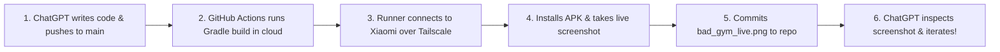

> **CURRENT DESIGN AUTHORITY (2026-11-15):** Read [CURRENT_DESIGN_SPEC.md](CURRENT_DESIGN_SPEC.md) first. The latest approved UI is the user's red/crimson/gold/white BAD GYM reference. Royal Purple / Neon-Glow is historical and superseded. Member profile card must use a coordinated red treatment including payment, expiry and membership progress; vertical rail is burgundy/red. Do not hardcode the old purple design. Device verification must be based on current CI artifacts only; Wireless Debugging ports are dynamic, never assume 5555.

# 🤖 CHATGPT AI AGENT COCKPIT — ZERO-LAPTOP PROTOCOL

This file provides direct, actionable instructions for ChatGPT and any AI coding agent operating on this repository.

---

## 🎯 1. Repository Architecture
* **Repository:** `explorelearningvisit-boop/productionreadymembercard`
* **Production Branch:** `main`
* **Application ID:** `com.badgym.bad_gym`
* **Main Activity:** `com.badgym.bad_gym/.MainActivity`
* **Build Engine:** 100% Cloud GitHub Actions (`.github/workflows/android-cloud-device.yml`)
* **Gradle Wrapper:** Checked into git (`android/gradlew` + `gradle-wrapper.jar`), AGP `9.1.1`, Gradle `9.3.1`

---

## 🔁 2. Autonomous Cloud-First Workflow (Zero-Laptop Loop)

### 1. Code Changes:
* When designing UI/UX or adding features in `lib/`, commit directly to `main` (or via Pull Request).
* Always follow Flutter best practices and maintain clean widget trees.

### 2. Cloud Gradle Build:
* You **never** need to run Gradle on a local computer.
* GitHub Actions runner spins up on Ubuntu, runs `flutter analyze`, `flutter test`, and `flutter build apk --release`.
* Output APK is uploaded as a workflow artifact.

### 3. Over-The-Air Device Install & Live Screenshot:
* The cloud runner connects to the user's phone via Tailscale (`100.123.18.54:<current-wireless-debugging-port>`, hostname `xiaomi-11i`).
* It streams `adb install -r app-release.apk` directly to the phone.
* It launches `com.badgym.bad_gym/.MainActivity`, takes a live screencap, and saves it to:
  `docs/screenshots/bad_gym_live.png`

### 4. Visual Verification (For ChatGPT):
* **Do NOT ask the user to manually take or upload screenshots.**
* Simply read `docs/screenshots/bad_gym_live.png` directly from this repository to inspect the live render on the physical Xiaomi 11i 5G display.
* Analyze padding, typography, alignment, contrast, and layout, then iterate!

---

## 📱 3. Target Device Profile
* **Device:** Xiaomi 11i 5G (`21091116I`)
* **Display:** 1080×2400 @ 2.75x density, Android 13 (MIUI)
* **Tailscale Hostname:** `xiaomi-11i`
* **Tailscale IP:** `100.123.18.54:<current-wireless-debugging-port>`

---

## 🔐 4. GitHub Secrets Configured
* `DEVICE_ADB_PRIVATE_KEY_B64`: Required: DEVICE_ADB_PRIVATE_KEY_B64 (verify presence in workflow; never commit key)
* `ANDROID_DEVICE_PORTS_JSON`: ✅ Configured (`{"xiaomi-11i": <current-port>}`)
* `TAILSCALE_AUTHKEY` / `TS_OAUTH_CLIENT_ID`: Add in GitHub Settings → Secrets to enable auto-joining Tailscale from cloud runner.
