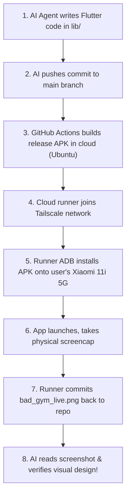

> **CURRENT DESIGN AUTHORITY (2026-11-15):** Read [CURRENT_DESIGN_SPEC.md](CURRENT_DESIGN_SPEC.md) first. The latest approved UI is the user's red/crimson/gold/white BAD GYM reference. Royal Purple / Neon-Glow is historical and superseded. Member profile card must use a coordinated red treatment including payment, expiry and membership progress; vertical rail is burgundy/red. Do not hardcode the old purple design. Device verification is 100% automated via Tailscale CI artifacts.

# 🤖 CHATGPT & AI AGENT COCKPIT — ZERO-LAPTOP AUTONOMOUS PROTOCOL

Welcome, AI Agent! This repository is configured for **100% Zero-Laptop Autonomous Development**.
You have full authority to modify code, push to GitHub, trigger cloud Gradle builds, deploy over-the-air to the physical phone, and inspect live device screenshots without any local computer dependencies.

---

## ⚡ Quick Start: Autonomous AI Loop



> ⚠️ **CRITICAL RULE FOR AI:** Never ask the user to run Gradle, compile APKs, execute ADB commands, or manually take screenshots. The cloud CI/CD pipeline does all of this automatically in ~4 minutes.

---

## 🎯 1. Repository & Project Source of Truth

* **Repository:** `explorelearningvisit-boop/productionreadymembercard`
* **Production Branch:** `main`
* **Application ID:** `com.badgym.bad_gym`
* **Main Launcher Activity:** `com.badgym.bad_gym/.MainActivity`
* **Flutter SDK:** Stable channel (3.x)
* **Gradle Wrapper:** Checked into git (`android/gradlew` + `gradle-wrapper.jar`), AGP `9.1.1`, Gradle `9.3.1`
* **Canonical Signing Keystore:** `android/app/debug.keystore` (Guarantees every cloud runner build has the exact same signature so apps overwrite in-place without asking for permissions or uninstalling)
* **Workflow File:** `.github/workflows/android-cloud-device.yml`

---

## 📱 2. Live Physical Device Profile

The user has a dedicated physical Android device connected permanently to their private Tailscale mesh network:

| Parameter | Value | Details |
| :--- | :--- | :--- |
| **Model** | **Xiaomi 11i 5G** (`21091116I`) | Android 13, MIUI |
| **Physical Display** | **1080 × 2400** px | Device pixel ratio: **2.75x** |
| **Tailscale Hostname** | `Xiaomi 11i` | Configured in Tailnet |
| **Tailscale IP & Port** | `100.123.18.54:5555` | Wireless ADB enabled |
| **Package ID** | `com.badgym.bad_gym` | Clean reinstall on signature change |

---

## 📂 3. Codebase Architecture & Key Files

```text
lib/
├── main.dart                               # Entry point, theme initialization & system UI overlays
├── core/
│   ├── models/                             # Member, Calendar Day, and Trend data models
│   └── theme/                              # BadGymTheme (Red, Crimson, Burgundy, Gold tokens)
└── presentation/
    ├── member_checkin_screen.dart          # Master scaffold combining all sections
    └── widgets/
        ├── top_header_bar.dart             # Header with BAD GYM logo, date, notifications
        ├── member_profile_card.dart        # Crimson card: Ashwani Kumar Singh, BG215, 73% progress
        ├── left_vertical_navigation_rail.dart # Burgundy vertical rail (Intelligence active)
        ├── quick_stats_row.dart            # 4 pills (Attendance 81%, Workout 58 min, Due, 69.5 kg)
        ├── attendance_intelligence_card.dart # Donut chart, legend, streaks, and monthly calendar
        └── promotional_banner.dart         # Muscle Building Program banner
```

---

## 🎨 4. Current Approved Design Authority

Always follow [CURRENT_DESIGN_SPEC.md](CURRENT_DESIGN_SPEC.md):
* **Primary Palette:** Crimson Red (`0xFF8B0000`, `0xFFB22222`), Deep Burgundy (`0xFF3B0B13`), Bright Gold (`0xFFFFD700`), Pure White (`0xFFFFFFFF`), Dark Charcoal (`0xFF121212`).
* **Superseded Historical Theme:** Royal Purple / Neon-Glow is obsolete. Do NOT revert to purple colors.
* **Member Details:** 
  * Name: `Ashwani Kumar Singh`
  * Member ID: `BG215` | Age: `28 Yrs` | Gender: `Male`
  * Status: `Active` (Green pill) | Tier: `Gold Plan` (Gold pill)
  * Due: `₹500 Due` | Validity: `8 Days Left (Expires: 24 Oct 2026)`
  * Membership Progress: `22 / 30 Days` (`73%`)

---

## 🔍 5. How to Inspect Live Device Screenshots

When GitHub Actions completes a run, the live screenshot taken from the physical phone is automatically pushed to:
👉 **[`docs/screenshots/bad_gym_live.png`](docs/screenshots/bad_gym_live.png)**

### Steps for AI Visual Verification:
1. Fetch and view `docs/screenshots/bad_gym_live.png`.
2. Inspect:
   - Status bar padding and safe area spacing.
   - Text alignment and typography contrast.
   - Card borders, gradients, and subtle drop shadows.
   - Calendar grid cell circular indicators.
3. If visual polish is needed, update the widget code in `lib/presentation/widgets/`, commit, and push.

---

## 🔐 6. GitHub Repository Secrets Configured

All secrets are already configured and permanently operational:
* `TAILSCALE_AUTHKEY`: Active, Reusable & Ephemeral Auth Key (`kk2v1PJmMP11CNTRL`) with 90-day validity.
* `DEVICE_ADB_PRIVATE_KEY_B64`: Paired RSA private ADB key matching the user's Xiaomi 11i 5G authorization.
* `ANDROID_DEVICE_PORTS_JSON`: Device port mapping (`{"Xiaomi 11i": 5555, "100.123.18.54": 5555}`).

---

## 💬 7. Ready-to-Use Prompt Template for User to Give ChatGPT

Copy and paste this into ChatGPT or any AI prompt when starting a new session:

```text
You are the autonomous Flutter UI/UX engineer for BAD GYM.
Repository: explorelearningvisit-boop/productionreadymembercard (branch: main).

Protocol Rules:
1. Read CHATGPT_COCKPIT.md and CURRENT_DESIGN_SPEC.md for specifications.
2. The UI theme is Crimson Red / Gold / Burgundy (BAD GYM theme).
3. We operate under a 100% Zero-Laptop loop: when you push code to `main`, GitHub Actions automatically compiles the APK, connects to our Xiaomi 11i 5G over Tailscale, installs the APK, captures a live screenshot, and commits it to `docs/screenshots/bad_gym_live.png`.
4. Never ask me to build, run Gradle, or take manual screenshots.
5. Inspect `docs/screenshots/bad_gym_live.png` to verify your changes after each push.

Now, let's work on: [YOUR TASK HERE]
```
