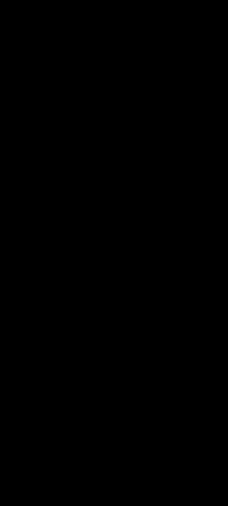
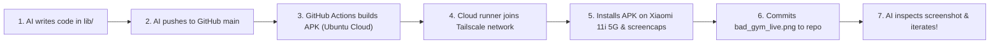

# BAD GYM — Member Intelligence (Flutter Mobile App)

Cross-platform Flutter application for the **BAD GYM Member Intelligence** check-in card experience. Designed and engineered for production with a **100% Zero-Laptop Autonomous Cloud CI/CD Pipeline**.

---

## 📸 Verified Live Physical Device Screenshot

Captured over-the-air via Tailscale ADB from the user's **Xiaomi 11i 5G** display:



---

## 🎨 Current Scope & Visual Implementation

This repository is dedicated to the production-quality, pixel-perfect **BAD GYM Member Intelligence** card:
- **Top Header Bar**: Rounded dark menu button, golden leaf icon, BAD GYM typography, notification bell with unread badge (`3`), and live date pill (`07:12 AM, 16 Oct 2026`).
- **Check-In Banner**: Check-In Success banner featuring biceps graphic, gold checkmark, and motivational typography.
- **Member Profile Card**: Crimson gradient card with real portrait avatar, `Ashwani Kumar Singh`, `BG215 | 28 Yrs | ♂ Male`, `Active` + `Gold Plan` badges, `₹500 Due` payment pill, `8 Days Left (Expires: 24 Oct 2026)` calendar pill, and `Membership 22 / 30 Days (73%)` gold progress bar.
- **Left Vertical Navigation Rail**: Rounded burgundy rail with 5 navigation items (`Intelligence` active pill, `Calendar`, `History`, `Trend`, `More`).
- **Quick Stats Row**: 4 interactive stat cards (`Attendance 81%`, `Workout 58 min`, `Payment Due`, `Body 69.5 kg`).
- **Attendance Intelligence Card**:
  - Donut chart with 81% progress ring (25 / 31 Days).
  - Color-coded legend (Present 23, Late 2, Absent 2, Holiday 4).
  - Streak badges (5 Days streak flame, 14 Days best streak trophy).
  - Monthly calendar (October 2026) with day status indicators and green double ring for Today (16th).

---

## 🤖 Zero-Laptop Autonomous AI Loop (For ChatGPT & AI Agents)

> **Complete AI Guide:** See [CHATGPT_COCKPIT.md](CHATGPT_COCKPIT.md) and [AGENTS.md](AGENTS.md).



### Why Zero-Laptop?
1. **Zero Local Gradle Builds:** You never compile APKs or run Gradle locally. Cloud runners handle 100% of the build in ~3 minutes.
2. **Zero Manual Screenshots:** The cloud runner automatically connects to the phone over Tailscale (`100.123.18.54:5555`), installs the APK, launches the app, captures the screenshot, and pushes `docs/screenshots/bad_gym_live.png` back to `main`.
3. **Full AI Autonomy:** ChatGPT or any AI can read `docs/screenshots/bad_gym_live.png` directly from the repo, verify visual changes, and continue improving the UI.

---

## 📱 Hardware & Target Device Specifications

| Parameter | Value | Details |
| :--- | :--- | :--- |
| **Model** | **Xiaomi 11i 5G** (`21091116I`) | Android 13, MIUI |
| **Physical Display** | **1080 × 2400** px | Device pixel ratio: **2.75x** |
| **Tailscale Hostname** | `Xiaomi 11i` | Auto-discovered by cloud runner |
| **Tailscale device IP** | Previously observed `100.123.18.54` | Verify live; may change |\n| **Wireless ADB port** | Dynamic | Discover current connect port; never assume 5555 |
| **Package ID** | `com.badgym.bad_gym` | Clean reinstall on signature update |
| **Launcher Activity** | `com.badgym.bad_gym/.MainActivity` | Auto-launched after build |

---

## 📂 Project Structure

```text
lib/
├── main.dart                               # App entry point, System UI overlays & theme
├── core/
│   ├── models/                             # Member, Calendar Day, and Trend models
│   └── theme/                              # BadGymTheme (Red, Crimson, Burgundy, Gold tokens)
└── presentation/
    ├── member_checkin_screen.dart          # Master screen assembly
    └── widgets/
        ├── top_header_bar.dart             # Header with BAD GYM logo, date, notification bell
        ├── member_profile_card.dart        # Crimson card: member stats, payment due, progress
        ├── left_vertical_navigation_rail.dart # Burgundy vertical rail (Intelligence active)
        ├── quick_stats_row.dart            # 4 quick stats cards
        ├── attendance_intelligence_card.dart # Donut chart, legend, streaks & calendar
        └── promotional_banner.dart         # Banner section
```

---

## 🏗️ Local Development (Optional)

If running locally on a developer machine:

```powershell
flutter pub get
flutter analyze
flutter test
flutter run
```

---

## 🤖 AI continuity and network architecture\n\n- [AI Context Bootstrap](docs/AI_CONTEXT_BOOTSTRAP.md) — mandatory start-here guide and copy-ready new-chat prompt.\n- [Network Architecture](docs/NETWORK_ARCHITECTURE.md) — supported Wi-Fi/hotspot/cellular/USB/Ethernet topologies and dynamic ADB discovery design.\n- [Decision Log](docs/DECISION_LOG.md) — dated decisions and superseded choices.\n- [AI Shared Communication Hub](AI_SHARED_COMMUNICATION_HUB.md) — chronological cross-agent handoff.\n- [AI Sync State](AI_SYNC_STATE.json) — machine-readable current project/device/CI state.\n\n## 📄 Key Documentation

- [CHATGPT_COCKPIT.md](CHATGPT_COCKPIT.md) — Autonomous guide, workflow rules, and prompt template for AI agents.
- [AGENTS.md](AGENTS.md) — Execution rules, device profile, and ADB fallback protocol.
- [CURRENT_DESIGN_SPEC.md](CURRENT_DESIGN_SPEC.md) — Comprehensive visual design specification.
- [.github/workflows/android-cloud-device.yml](.github/workflows/android-cloud-device.yml) — Authoritative GitHub Actions workflow.


## 🖥️ Windows Local Agent + MCP

The repository includes an optional Windows MCP execution agent for direct USB/Wireless ADB iteration, screenshot return, device logs, bounded screen interaction, Flutter analyze/test/build, and guarded code changes. Start with [docs/LOCAL_AGENT_SETUP.md](docs/LOCAL_AGENT_SETUP.md) and [tools/badgym_local_agent/README.md](tools/badgym_local_agent/README.md). The agent is separate from the Flutter runtime; GitHub Actions remains the cloud build and device-QA pipeline. ChatGPT mobile custom MCP is not currently supported; see the setup guide for Secure MCP Tunnel and product eligibility constraints.


## Universal AI engineering rules

Every AI or developer must start with [the Universal AI Engineering Constitution](docs/AI_AGENT_OPERATING_CONSTITUTION.md). Tool-specific entrypoints are provided for [Gemini / Antigravity](GEMINI.md), [Claude](CLAUDE.md), [GitHub Copilot](.github/copilot-instructions.md), and [Cursor](.cursor/rules/bad-gym-project.mdc). The constitution defines how to load project context, interpret voice/screenshot requests, resolve design decisions, work across agents, validate CI/device builds, protect user data, and persist handoffs.
